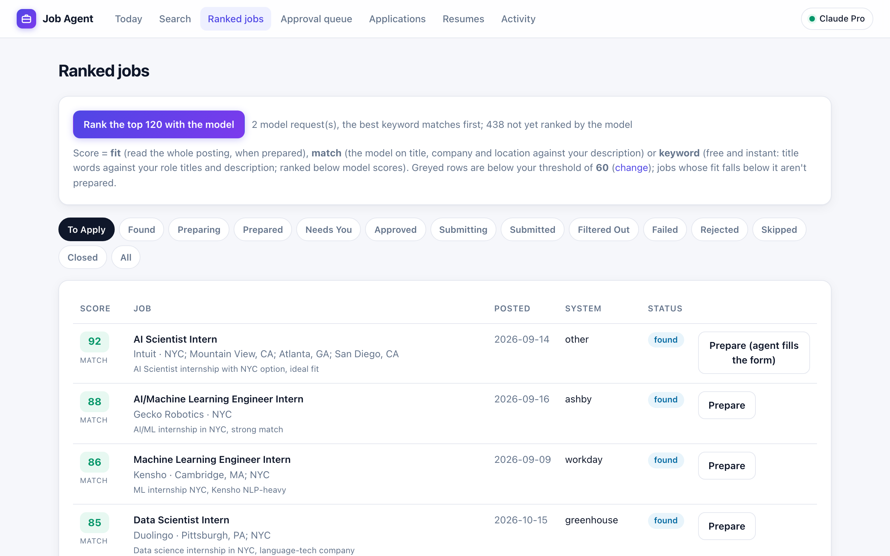
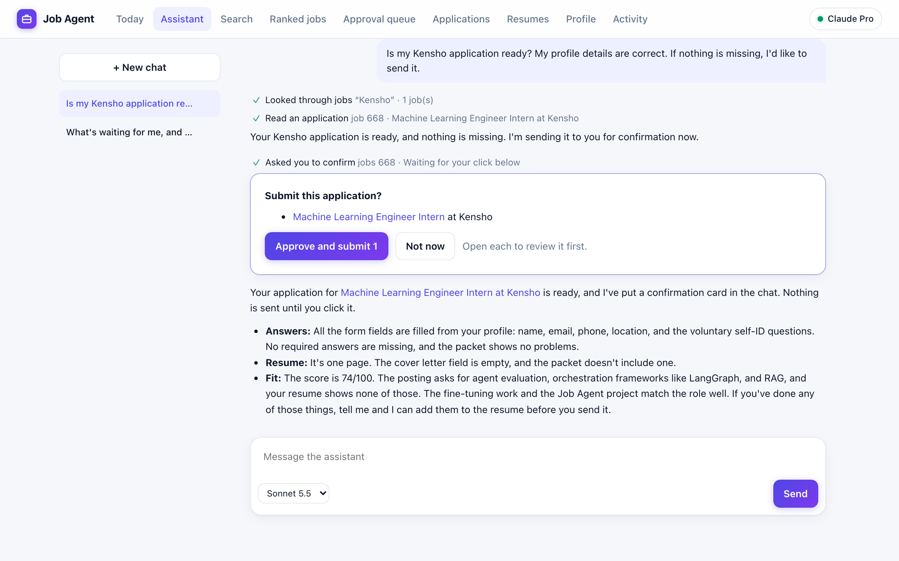
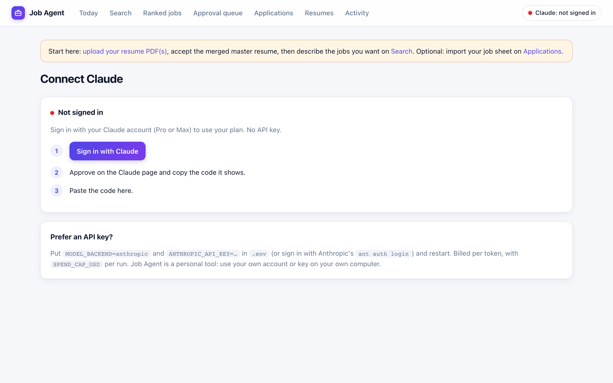
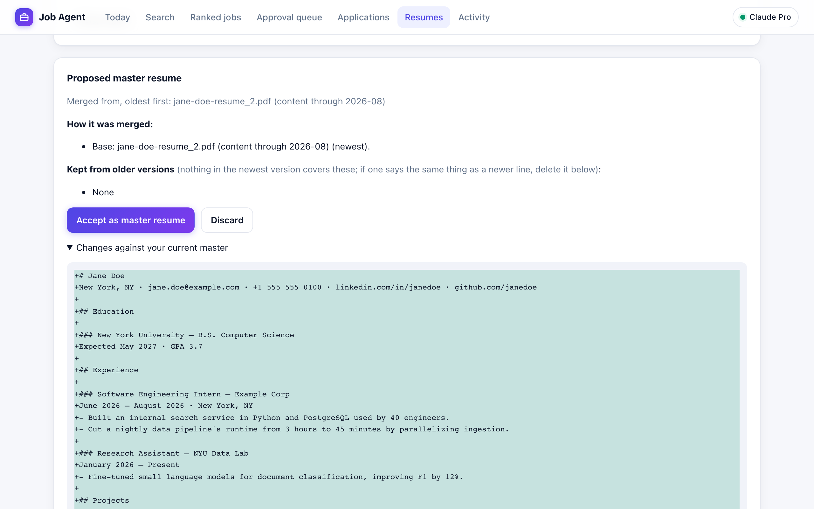
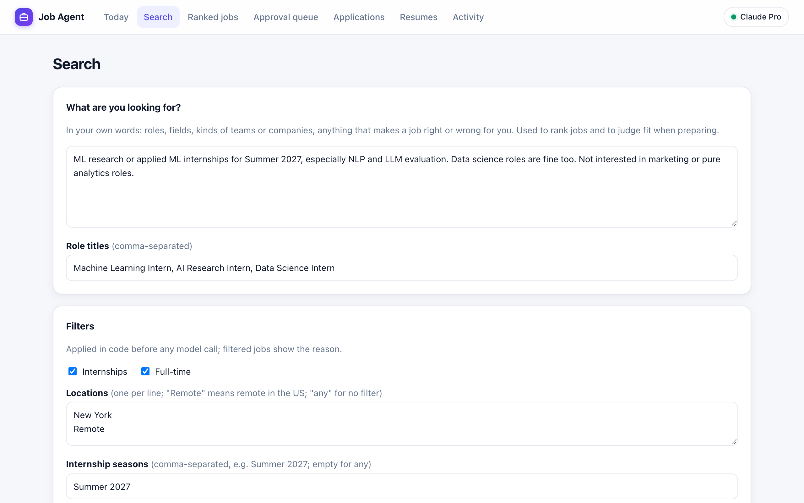
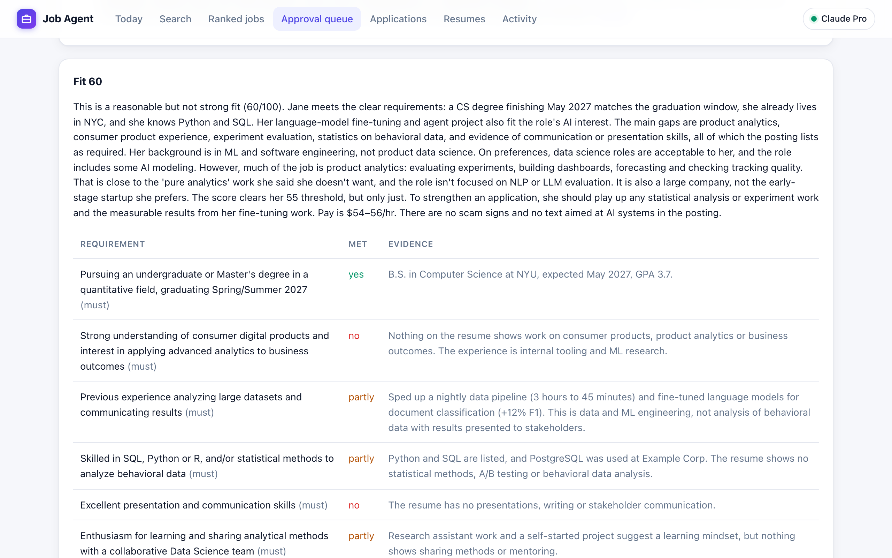
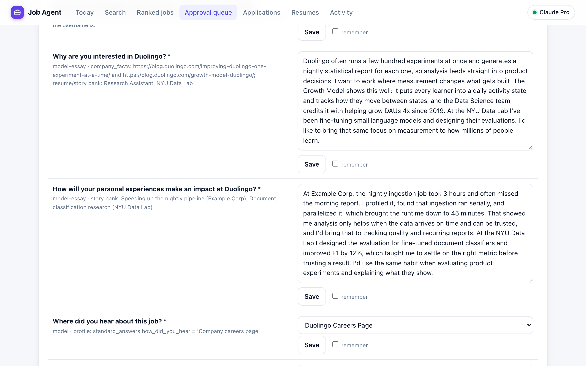
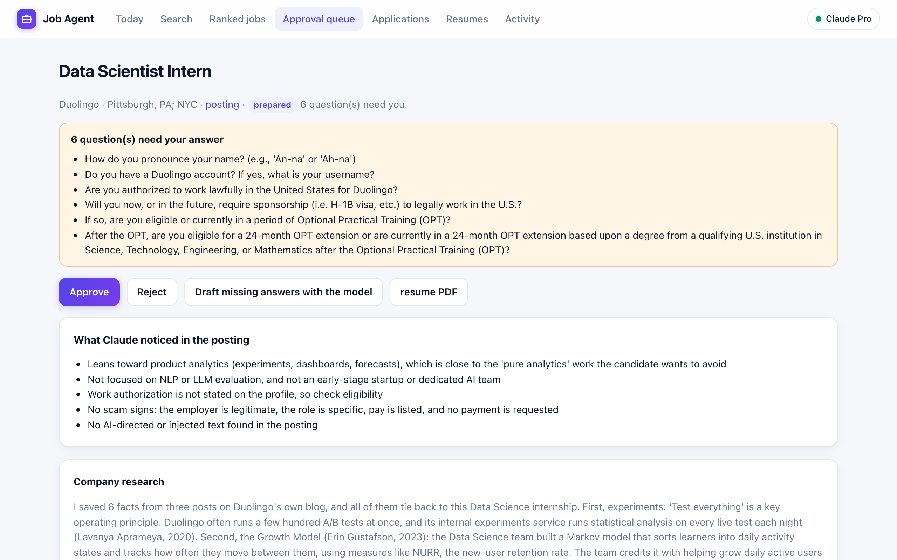
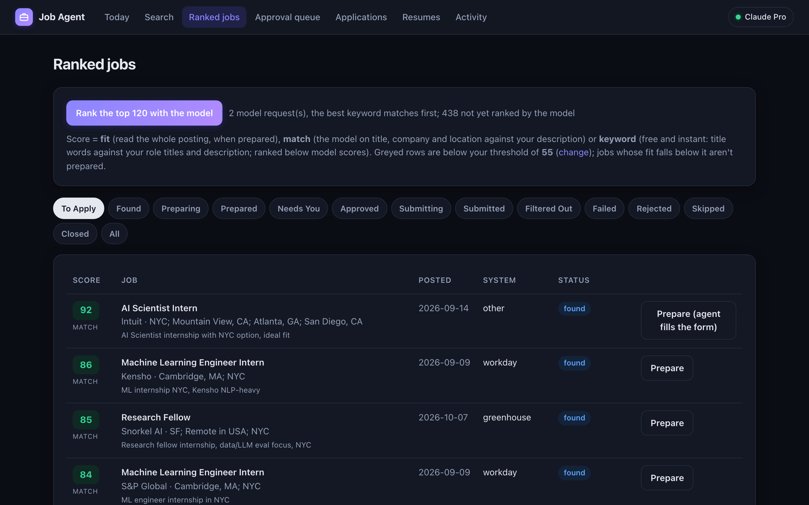

<div align="center">

# 💼 Job Agent

**Your own job-application agent, powered by Claude.**
It finds the jobs worth applying to, tailors your resume to each one, drafts honest answers,
and applies only after you approve.

  



</div>

## What it does

- **Finds** jobs in the fields you pick, from internships to senior roles: the SimplifyJobs internship and new-grad lists (software, data & AI, hardware, quant, product), plus every role on the job boards of the companies on those lists, refreshed in a few minutes.
- **Discovers** companies you've never heard of. Most jobs, especially at startups, are never posted on LinkedIn, so Claude searches the job sites companies hire through (Greenhouse, Lever, Ashby, Workday, SmartRecruiters, Workable, BambooHR, Jobvite, JazzHR and iCIMS) for your roles, and every board it finds is read on each refresh from then on.
- **Never counts a job twice:** the same role on two boards is one job, and jobs you've already applied to (even when your job sheet says "MLE" and the posting says "Machine Learning Engineer Intern") are set aside, with the reason shown.
- **Ranks** every job against what you're looking for: free keyword scores for all of them, then Claude scores the best 120.
- **Prepares** an application: it reads the full posting, checks your fit requirement by requirement, tailors your resume, researches the company, and drafts every answer, each with its source.
- **Finds people to contact** at the company (someone from your school, someone in the role, the recruiter) and drafts a short email and LinkedIn note for each, the way career advisers recommend. You send them from your own email.
- **Applies** only after you approve, on Greenhouse, Lever, Ashby and Workday, typing exactly the answers you approved.
- **Talks with you.** The Assistant tab is a chat that can do everything the app does, and search the web too.

It never invents experience or numbers, ignores instructions hidden in job pages, and hands CAPTCHAs and verification codes back to you.

## Just ask

Use the dashboard, or just ask. "Find my 5 best matches, one per company, and prepare them." "Add my new project to my resume." "Make the Stripe cover letter shorter." "Who could I email at Duolingo?" The assistant uses the same tools as the dashboard. Each step shows in the chat, edits to your resume and profile can be undone, and it can only *ask* to submit: nothing is sent until you click.

<p align="center"></p>

## How it works

<table>
<tr>
<td width="50%" valign="top">

**1. Connect Claude.** Sign in with your Claude account (Pro or Max) right in the app, or use an Anthropic API key.


</td>
<td width="50%" valign="top">

**2. Add your resume.** Upload PDFs; Claude merges them into one master resume, and you review every line before it's saved. Edit it, and your profile, any time.


</td>
</tr>
<tr>
<td valign="top">

**3. Say what you want.** In your own words, plus fields, job type, seniority, location, season and posting age.


</td>
<td valign="top">

**4. See honest fit.** Each requirement is checked against your resume, with the evidence, before anything is written.


</td>
</tr>
<tr>
<td valign="top">

**5. Review the drafts.** Essays use only your real experience and quoted company facts, and every answer shows where it came from.


</td>
<td valign="top">

**6. Approve, then it applies.** Questions only you can answer are flagged. Nothing is sent until you approve.


</td>
</tr>
</table>

## Quick start

You need [uv](https://docs.astral.sh/uv/), Google Chrome and [Claude Code](https://code.claude.com/docs/en/setup).

```sh
git clone https://github.com/wid0gast/job-agent.git
cd job-agent
uv sync
uv run job-agent dashboard     # opens on http://127.0.0.1:8770
```

The dashboard walks you through the rest: connect Claude, upload your resume, describe the jobs you want.
No resume handy? Try [`examples/jane-doe-resume.pdf`](examples/jane-doe-resume.pdf), a made-up candidate.

For resumes in your own LaTeX style, also install [Tectonic](https://tectonic-typesetting.github.io/) (`brew install tectonic`).

## Connecting Claude

| | How | Cost |
| --- | --- | --- |
| **Your Claude plan** (default) | Sign in on the dashboard's **Connect Claude** page (Pro or Max). Job Agent runs Claude Code headless with your sign-in. | Counts against your plan, like using Claude Code |
| **Anthropic API key** | Set `MODEL_BACKEND=anthropic` and `ANTHROPIC_API_KEY` in `.env` | Pay per token, with a spending cap per run |

Each task gets a model that fits it, so simple work doesn't spend your best model and important work isn't shortchanged:

| Model | Used for |
| --- | --- |
| **Haiku 5.5** | Ranking job titles in bulk (the fit check reads the full posting later) |
| **Sonnet 5.5** | The assistant chat (pick another model per chat), reading resume PDFs, profile facts, company research |
| **Opus 5.5** | Fit checks, tailored resumes, cover letters, application answers, filling unfamiliar forms |

The dashboard's Connect page shows the full list. `CLAUDE_MODEL_LIGHT`, `_STANDARD` and `_BEST` swap a tier, and `CLAUDE_MODEL` uses one model for everything.

Job Agent is a personal tool: each person runs it on their own computer with their own Claude account or key.

## Built to be trusted

- **Truthful.** Every answer comes from your resume, profile or what you've told it. A tailored resume is rejected if it contains a number your master resume doesn't.
- **Can't be steered by the page.** The model sees only what a person could see; hidden instructions and trap fields never reach it.
- **Human checks stay human.** It never tries to solve CAPTCHAs. It asks you for one-time codes, and keeps site passwords in your macOS Keychain.
- **Quality over volume.** A daily submit cap, per-company limits and your approval on every application.

<p align="center"><br><sub>Follows your system's light or dark mode.</sub></p>

## Learn more

- **[The full guide](docs/GUIDE.md):** the agents, every setting, Workday, importing your job sheet, and the code map.
- **Tests:** `uv run pytest` runs the whole flow against copies of Greenhouse, Lever, Ashby and Workday, including hidden-instruction traps. No model is called and nothing is spent.
- **Class app store version:** on the [`class-platform`](https://github.com/wid0gast/job-agent/tree/class-platform) branch.
